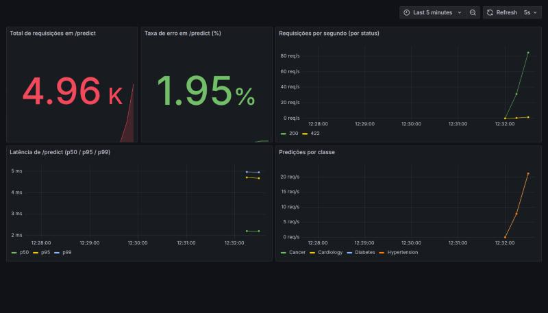

# Tech Challenge Fase 3 — Triagem automática de laudos médicos

Serviço de classificação de textos médicos servido por API REST em container
Docker, com pipeline de CI (GitHub Actions) e DAG de retreino (Airflow).

## Dataset

`data/raw/medical_text_classification_fake_dataset.csv`: colunas `text` e `label`.

| Característica | Valor |
|---|---|
| Linhas | 1.000 |
| Classes | Cancer, Diabetes, Cardiology, Hypertension (250 cada) |
| Frases únicas | **20** (5 por classe, repetidas várias vezes) |

**Limitações em relação ao enunciado:** o enunciado sugere ≥ 2.000 amostras e uma
classe de urgência (normal / atenção / urgente). Este dataset tem 1.000 linhas e o
alvo é a **especialidade** do texto. Não criamos um mapeamento especialidade → urgência
porque ele não teria base clínica. Para trocar o alvo por urgência basta fornecer um CSV
com as mesmas colunas (`text`, `label`) e apontar `DATA_PATH` para ele.

### Avaliação sem vazamento

Como só existem 20 frases únicas, um split aleatório coloca a mesma frase no treino e no
teste. Nesse caso a acurácia chega a **100%**, sem medir generalização. Em `src/data.py`
separamos frases inteiras (1 por classe) para o teste, e a validação cruzada agrupa por
frase. Resultado atual (`python -m src.train`):

| Métrica | Valor |
|---|---|
| Acurácia em frases inéditas (4 frases) | 0,27 |
| F1 macro em frases inéditas | 0,17 |
| Acurácia média na validação cruzada agrupada (5 folds) | 0,39 |
| Referência (acaso, 4 classes) | 0,25 |

O modelo só reconhece as frases que viu no treino. Com 5 frases por classe, não há
vocabulário suficiente para generalizar. Um dataset maior e mais variado é o principal
ponto de melhoria do projeto.

## Estrutura do projeto

```
├── data/raw/            # dataset (CSV versionado, 80 KB)
├── src/
│   ├── config.py        # configuração via .env
│   ├── data.py          # carga, validação e split sem vazamento
│   ├── train.py         # TF-IDF + modelo, avaliação, salvamento e export ONNX
│   ├── pipeline.py      # etapas ingestão/treino usadas pela DAG
│   └── api.py           # API FastAPI (/health, /predict e /metrics)
├── dags/retrain_dag.py  # DAG do Airflow
├── monitoring/          # Prometheus e Grafana (datasource + dashboard provisionados)
├── docker-compose.yml   # API + Prometheus + Grafana
├── scripts/
│   ├── benchmark_latency.py  # latência da API via HTTP
│   └── compare_latency.py    # scikit-learn x ONNX Runtime (só o modelo)
├── tests/               # pytest
├── .github/workflows/ci.yml
└── Dockerfile
```

## Como executar

Pré-requisitos: Python 3.11+, [Poetry](https://python-poetry.org/) e Docker.

```bash
poetry install
cp .env.example .env
poetry run python -m src.train          # gera models/model.joblib e models/model.onnx
poetry run uvicorn src.api:app --reload # API em http://localhost:8000/docs
```

Exemplo de chamada:

```bash
curl -X POST localhost:8000/predict -H 'content-type: application/json' \
  -d '{"text": "Insulin therapy remains the cornerstone for type 1 diabetes treatment."}'
# {"label":"Diabetes","confidence":0.9348,"latency_ms":0.181}
```

### Docker

```bash
docker build -t triagem-api:0.1 .
docker run --rm -p 8000:8000 triagem-api:0.1
```

O modelo é treinado durante o build, então a imagem já sobe pronta.

## Baseline de latência (local, container Docker)

Medido com `poetry run python -m scripts.benchmark_latency` (200 requisições
sequenciais a `localhost:8000`, após aquecimento), em um MacBook com Docker Desktop:

| Métrica | Tempo |
|---|---|
| Média | 1,07 ms |
| p50 | 1,03 ms |
| p95 | 1,37 ms |
| Máximo | 3,18 ms |

É o ponto de comparação para a otimização da Etapa 4.

## Otimização de latência (ONNX Runtime)

Ao fim do treino, `src/train.py` converte o pipeline (TF-IDF + regressão logística)
para ONNX com `skl2onnx` e grava `models/model.onnx` ao lado do `model.joblib`. A API
carrega o `.onnx` e faz a inferência com o **ONNX Runtime**. O pipeline scikit-learn
continua salvo para comparação.

Por que ONNX: o scikit-learn passa por várias camadas Python a cada chamada (validação,
vetorização, matriz esparsa). O ONNX Runtime executa o mesmo grafo em C++ numa única
chamada. Quantização e pruning dariam pouco ganho aqui, porque o modelo já é pequeno (18 KB).

Dois detalhes da conversão:

- `zipmap=False`: as probabilidades saem como tensor, e não como lista de dicionários;
- `locale="C"` no TF-IDF: o operador que converte para minúsculas usa `en_US.UTF-8` por
  padrão, e esse locale não existe na imagem `python:3.11-slim`.

### Resultados (mesma máquina Linux, 2026-11-02)

**Só o modelo** (`poetry run python -m scripts.compare_latency --n 2000`, 1 texto por chamada):

| Modelo | Média | p50 | p95 | Tamanho |
|---|---|---|---|---|
| scikit-learn (joblib) | 1,103 ms | 1,045 ms | 1,415 ms | 18 KB |
| ONNX Runtime | **0,040 ms** | **0,037 ms** | **0,071 ms** | 14 KB |

Ganho de **~27x** na média, com 100% de concordância de rótulos nas frases do dataset. As
probabilidades diferem em até ~0,01 porque a tokenização do ONNX não é idêntica à do
scikit-learn. Um teste em `tests/test_train.py` garante os mesmos rótulos.

**API ponta a ponta em Docker** (`scripts.benchmark_latency --n 1000`, imagem antes e
depois da mudança):

| API | Média | p50 | p95 |
|---|---|---|---|
| scikit-learn | 4,05 ms | 3,91 ms | 4,86 ms |
| ONNX Runtime | **2,83 ms** | **2,64 ms** | **3,40 ms** |

Na API o ganho é de ~30%. O modelo passou de ~1 ms para ~0,04 ms, e o tempo que sobra
vem de HTTP, validação do FastAPI e métricas. O baseline da seção anterior (1,07 ms) foi
medido em outra máquina (MacBook) e não deve ser comparado diretamente com estes números.

## CI (GitHub Actions)

`.github/workflows/ci.yml` roda a cada `push` e `pull_request`, em três jobs
encadeados: **lint** (`ruff check` e `ruff format --check`) → **test** (`pytest`) →
**build** (`docker build`). Para rodar o mesmo localmente:

```bash
poetry run ruff check . && poetry run ruff format --check .
poetry run pytest
```

## Monitoramento (Prometheus + Grafana)

A API usa `prometheus_client` e expõe as métricas em `/metrics`:

| Métrica | Tipo | Rótulos |
|---|---|---|
| `http_requests_total` | Counter | `method`, `path`, `status` |
| `http_request_duration_seconds` | Histogram | `method`, `path` |
| `predictions_total` | Counter | `label` (classe prevista) |

O rótulo `path` usa o template da rota (ex.: `/predict`). URLs desconhecidas viram
`other`, para não criar uma série por URL.

Para subir a stack completa:

```bash
docker compose up -d --build
poetry run python -m scripts.benchmark_latency --n 1000   # gera tráfego
```

| Serviço | Endereço |
|---|---|
| API | http://localhost:8000/docs |
| Prometheus | http://localhost:9090 (coleta a API a cada 5 s) |
| Grafana | http://localhost:3000 (admin/admin; leitura anônima liberada) |

O Grafana já sobe com o datasource e o dashboard **Triagem de laudos — API**
provisionados (`monitoring/grafana/dashboards/triagem-api.json`). Painéis:

1. Total de requisições em `/predict`;
2. Taxa de erro em `/predict` (respostas 4xx/5xx, em %);
3. Requisições por segundo, por status;
4. Latência de `/predict` (p50, p95 e p99 do histograma);
5. Predições por classe.



Para encerrar: `docker compose down`.

## Orquestração (Airflow)

A DAG `retrain_text_classifier` (`dags/retrain_dag.py`) tem duas tarefas encadeadas:

1. `ingest_data`: lê e valida o CSV e grava `models/staging.csv`;
2. `train_model`: treina o classificador, salva `models/model.joblib` e
   `models/metrics.json`.

A lógica fica em `src/pipeline.py` (testável sem Airflow). O agendamento é semanal.
O Airflow é uma dependência opcional por ser pesada:

```bash
poetry install --with airflow
export AIRFLOW_HOME=$PWD/.airflow AIRFLOW__CORE__LOAD_EXAMPLES=False PYTHONPATH=.
poetry run airflow db migrate
poetry run airflow dags test retrain_text_classifier 2026-11-02 -S dags
poetry run pytest tests/test_dag.py   # integridade da DAG (pulado sem Airflow)
```

> Se o `poetry install --with airflow` apresentar conflito de versões, instale o Airflow
> em um ambiente separado usando o arquivo de *constraints* oficial da versão 2.10.

## Decisão arquitetural de deploy

**Contexto:** triagem de urgência de laudos. Uma resposta rápida ao profissional de saúde
é o objetivo, e o modelo é leve (TF-IDF + modelo linear, poucos MB).

**Inferência: tempo real (online).** O laudo chega, é classificado e a resposta volta na
mesma requisição. Um processamento em lote atrasaria justamente os casos urgentes. O
container FastAPI é *stateless*, então escala horizontalmente por réplicas.

**Treino/retreino: lote (batch).** Roda em agenda (Airflow) ou sob demanda, fora do
caminho da requisição, e publica um novo artefato de modelo.

**Nuvem escolhida: AWS** (Azure e GCP são equivalentes para este caso):

| Necessidade | Serviço AWS | Equivalentes |
|---|---|---|
| Registro da imagem | ECR | ACR / Artifact Registry |
| Execução da API | ECS Fargate atrás de um ALB, com auto scaling por CPU/latência | Container Apps / Cloud Run |
| Artefatos do modelo | S3 versionado | Blob Storage / GCS |
| Orquestração do retreino | MWAA (Airflow gerenciado) ou a DAG deste repositório em container | Cloud Composer |
| Métricas e logs | CloudWatch + Prometheus/Grafana | Azure Monitor / Cloud Monitoring |

**Por que não GPU nem serverless por função:** o modelo roda em CPU em ~0,04 ms (ONNX), então GPU
não compensa o custo. Funções sob demanda (Lambda) sofreriam com *cold start* num
fluxo clínico.

**Cuidados para produção real:** laudos são dados pessoais de saúde (LGPD). Seria
necessário TLS, autenticação na API, rede privada, criptografia em repouso e logs sem o
texto do laudo. A saída do modelo deve apoiar a priorização, e a decisão clínica continua
com o profissional.
